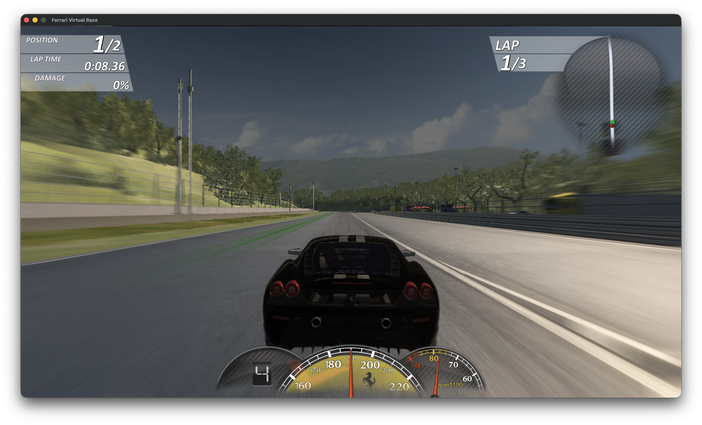

# Ferrari Virtual Race - macOS Static Recompilation Port

A native macOS (`x86_64`) port of *Ferrari Virtual Race* (2009) created by statically recompiling the original 32-bit Windows executable (`FerrariVR_Hi.exe`) into C and pairing it with a custom Win32 / DirectX host runtime built on SDL3 and OpenGL 4.1 Core.



> **Note:** This repository contains no original game binaries, copyrighted code, or game assets. You must supply your own copy of *Ferrari Virtual Race* to generate the recompiled C sources and run the game.

## Screenshots

| Main Menu | Car Selection |
| --- | --- |
|  |  |

## How It Works

1. **Function Discovery (`ghidra/`)** - [ExportFuncs.java](ghidra/ExportFuncs.java) exports function boundaries and computed-jump targets from `FerrariVR_Hi.exe` into [funcs_hi.jsonl](ghidra/funcs_hi.jsonl).
2. **Static Recompilation (`tools/`)** - [recomp.py](tools/recomp.py) and [fpu.py](tools/fpu.py) lift x86-32 integer, x87, SSE/SSE2, and MMX instructions into C functions over the `CPU` state struct defined in [cpu.h](runtime/cpu.h). Direct calls become C calls, intra-function branches become `goto`, flags are computed lazily by liveness analysis, and indirect calls/jumps go through `call_indirect()`.
3. **Native Runtime (`runtime/`)** - Maps a 4 GiB guest address space via `mmap`, loads the original PE sections from `FerrariVR_Hi.exe` at runtime, patches IAT slots to host thunks, and implements the required Windows and DirectX APIs natively:
   - **Graphics** - Direct3D 9 on OpenGL 4.1 Core (`d3d9.cpp`), fixed-function GLSL generation (`d3d9_ff.cpp`), Shader Model 2.x/3.0 bytecode-to-GLSL 4.10 translator (`d3d9_shader.cpp`), D3DX9 surface copy/screenshot helpers via ImageIO/CoreGraphics (`d3dx9.cpp`), and DirectDraw memory reporting (`ddraw.cpp`).
   - **Windowing & Input** - `user32` / `gdi32` (`user32.cpp`) and DirectInput 8 (`dinput8.cpp`) implemented over SDL3 for keyboard, mouse, and gamepads/wheels.
   - **Audio** - DirectSound 8 software mixer (`dsound.cpp`) outputting 48 kHz float stereo via SDL3.
   - **OS & Filesystem** - `kernel32`, `advapi32`, `shell32`, `shlwapi`, `ole32`, and `winmm` replacements (`kernel32.cpp`, `heap.cpp`, `seh.cpp`), including case-insensitive path resolution and a copy-on-write user overlay under `~/Library/Application Support/FerrariVirtualRace`.

## Repository Layout

```text
.
├── Makefile          - Build rules for the recompiler output, runtime, and tests
├── LICENSE           - GNU General Public License v3.0
├── README.md         - Project overview and build instructions
├── requirements.txt  - Python dependencies for the static recompiler tools
├── ghidra/           - Ghidra headless export script and exported function map
├── media/            - Screenshots of the native macOS build
├── runtime/          - C++ Win32, Direct3D 9, DirectInput 8, and DirectSound 8 runtime
├── tests/            - Standalone shader translation and GL compilation test
└── tools/            - Python x86-32 -> C static recompiler and inspection utilities
```

## Prerequisites

- macOS with Xcode Command Line Tools (`clang`, `clang++`, `make`)
- [SDL3](https://libsdl.org/) discoverable via `pkg-config` (`brew install sdl3 pkg-config`)
- Python 3 (for running the static recompiler)
- Original *Ferrari Virtual Race* installation files (including `FerrariVR_Hi.exe` and the game asset directories)

Note: [Makefile](Makefile) targets `-arch x86_64 -mmacosx-version-min=26.0`. Adjust `ARCH` in [Makefile](Makefile) if targeting an older macOS SDK version.

## Building

1. Set up the Python virtual environment and install dependencies:

   ```sh
   python3 -m venv .venv
   .venv/bin/pip install -r requirements.txt
   ```

2. Generate the C sources into `gen/` from your copy of `FerrariVR_Hi.exe`:

   ```sh
   make gen EXE=/path/to/FerrariVR_Hi.exe
   ```

   By default, `EXE` points to `../extracted/FerrariVR_Hi.exe`.

3. Compile the native binary (`build/fvr`):

   ```sh
   make -j
   ```

## Running

Point `FVR_GAME_DIR` at the directory containing `FerrariVR_Hi.exe` and the extracted game assets:

```sh
FVR_GAME_DIR=/path/to/game ./build/fvr
```

On first launch, [config.cpp](runtime/config.cpp) automatically writes a default windowed `Config.ini` under `~/Library/Application Support/FerrariVirtualRace/docs/Synetic/FerrariVR/Config.ini`. Any files modified or saved by the game are stored in the `overlay/` and `docs/` subdirectories there without modifying the original game directory.

### Useful Environment Variables

- `FVR_GAME_DIR` - Path to the original game files (defaults to `../Resources/game` next to the executable)
- `FVR_TRACE=1` - Log Win32 / DirectX API thunk calls to stderr
- `FVR_D3D_TRACE=1` - Log D3D9 calls to stderr
- `FVR_SHOT_FRAMES` / `FVR_SHOT_DIR` - Comma-separated frame indices and output directory for dumping PPM screenshots in `Present()`

## Testing & Utilities

- **Shader Translation Test** - Translates all D3D9 shader blobs embedded in `FerrariVR_Hi.exe` to GLSL 4.10 and compiles each one with macOS OpenGL 4.1 Core:

  ```sh
  make build/shadertest
  ./build/shadertest /path/to/FerrariVR_Hi.exe
  ```

- **Inspection Scripts (`tools/`)** - Helper scripts for PE layout inspection ([peinfo.py](tools/peinfo.py)), locating embedded D3D9 shaders ([find_shaders.py](tools/find_shaders.py)), and quick disassembly ([x86dis.py](tools/x86dis.py)).

## Support & Links

If you would like to support the project or follow updates:

- Ko-fi - https://ko-fi.com/blacklineinteractive
- Patreon - https://www.patreon.com/BlacklineInteractive
- YouTube - https://youtube.com/@blacklineinteractive
- X - https://x.com/demonv559
- Instagram - https://www.instagram.com/blacklineinteractive
- TikTok - https://www.tiktok.com/@blacklineinteractive
- LinkedIn - https://linkedin.com/in/blacklineinteractive

## License

This project is licensed under the GNU General Public License v3.0 - see the [LICENSE](LICENSE) file for details.

