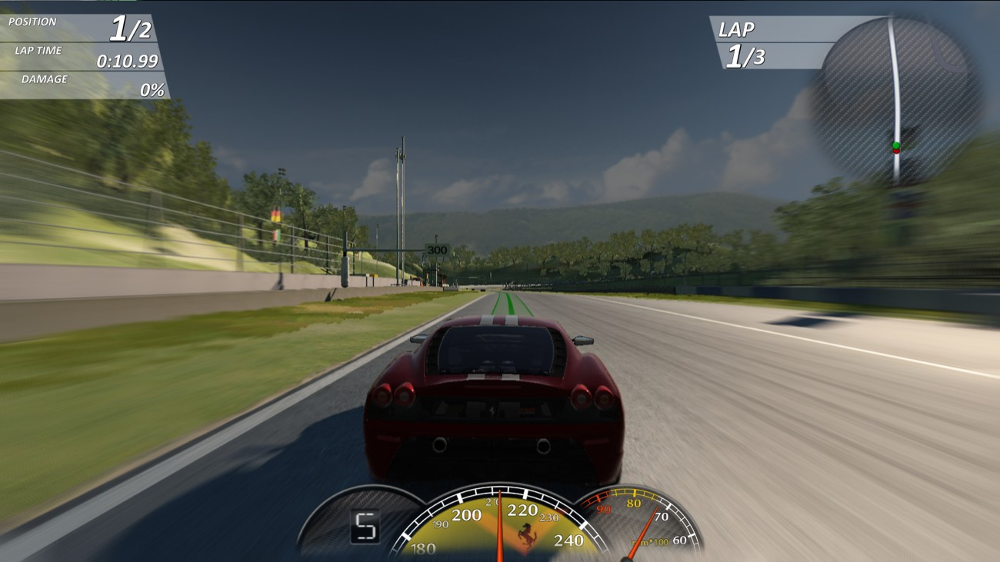
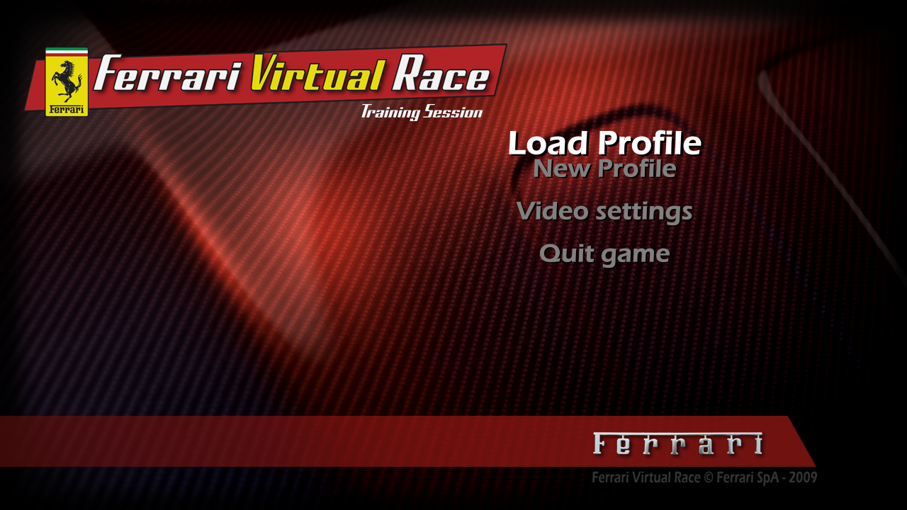
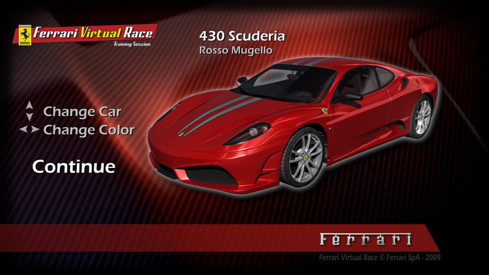
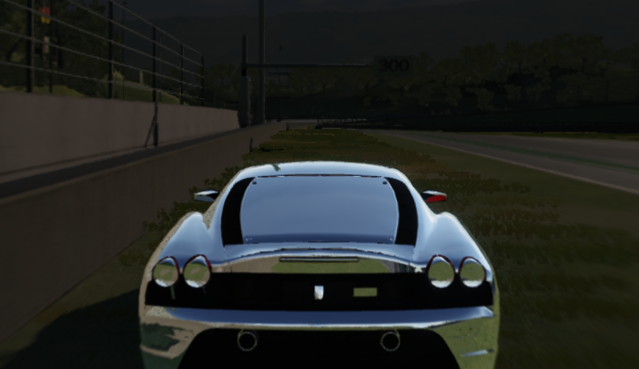
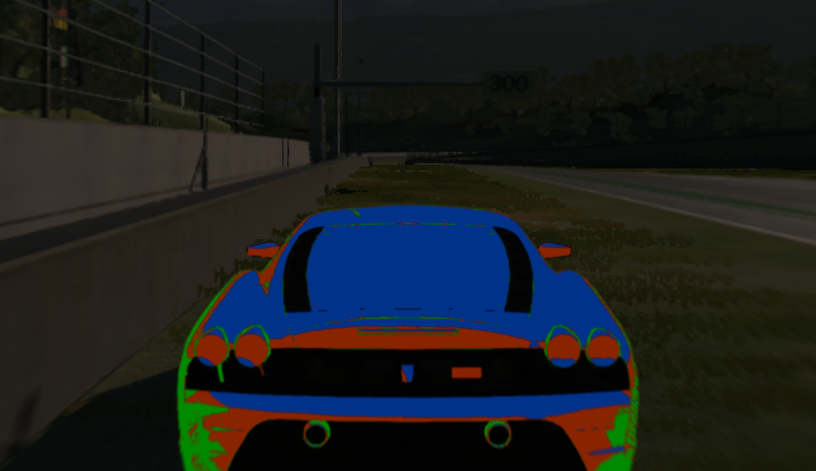

# Ferrari Virtual Race - macOS Static Recompilation Port

A native macOS (`x86_64`) port of *Ferrari Virtual Race* (2009) created by statically recompiling the original 32-bit Windows executable (`FerrariVR_Hi.exe`) into C and pairing it with a custom Win32 / DirectX host runtime built on SDL3 and OpenGL 4.1 Core.



> **Note:** This repository contains no original game binaries, copyrighted code, or game assets. You must supply your own copy of *Ferrari Virtual Race* to generate the recompiled C sources and run the game.

## Screenshots

| Main Menu | Car Selection |
| --- | --- |
|  |  |

## Quick Start

You need your own copy of *Ferrari Virtual Race* (the Windows release). Nothing from the game ships with this repository.

```sh
brew install sdl3 pkg-config sevenzip
git clone https://github.com/BlackLineInteractive/FerrariVirtualRace-MacOS-Port.git
cd FerrariVirtualRace-MacOS-Port
python3 -m venv .venv && .venv/bin/pip install -r requirements.txt

# 1. unpack the Windows installer (or use an already installed game folder)
tools/extract_game.sh ~/Downloads/ferrari-virtual-race-1-0-en-win.exe ../extracted

# 2. recompile the game and build the macOS app
make gen EXE=../extracted/FerrariVR_Hi.exe
make -j
make app GAME=../extracted      # -> build/FerrariVR.app
make install                    # optional: copy it to /Applications
```

Double-click `FerrariVR.app`. It finds the game folder by itself when it sits next to the app (or at `../extracted` from the repository); otherwise it asks for the folder once and remembers it. `make app GAME=<folder> EMBED=1` copies the game files into the bundle for a fully self-contained app on your own Mac. Do not share such a bundle, because it contains the game.

## Graphics Options

The port adds to the game's own *Video settings* menu:

| Setting | What the port adds |
| --- | --- |
| **Antialias** | `FXAA` (post filter), `MSAA 2x / 4x / 8x` (real multisampling of the HDR scene, alpha-to-coverage for alpha-tested foliage), `FSR 1` (MSAA 4x + AMD FidelityFX Super Resolution 1 upscaling to the Retina pixel size and RCAS sharpening), `Temporal AA`, `Temporal 1.5x`, `Temporal 2x` (see below) |
| **Resolution / Window size** | Every common size up to 2560x1440 (2K), 3840x2160 (4K) and the display's native Retina resolution. Sizes larger than the screen are scaled down to fit, which works as supersampling |
| **Shadow detail** | Hardware shadow maps (depth-compare PCF) like the original Windows drivers |
| **Ray tracing** *(new)* | `off` / `on`: ray-traced reflections on car paint, glass and chrome (see below) |
| **PBR materials** *(new)* | `off` / `on`: physically based car materials |
| **Ambient occlusion** *(new)* | `off` / `low` / `medium` / `high` (GTAO) |
| **Screen reflections** *(new)* | `off` / `low` / `medium` / `high`: reflections on the track |

Changing video settings recreates the device in-game; the port keeps running. The four new entries are added to the game's own menu by the port and take effect at once. Ray tracing, ambient occlusion and screen reflections need the 3D scene single-sampled, so while one of them is on they take precedence over MSAA: `MSAA 2x / 4x / 8x` then act as off and `FSR 1` keeps its upscaling and sharpening without MSAA underneath. The `Temporal` entries suit them best, since they also smooth their per-frame noise.

### More settings: options.txt

The same settings and a few more are in `~/Library/Application Support/FerrariVirtualRace/options.txt`. The first launch writes it with every setting commented out and explained; the menu entries above write their lines there. Edit it with any text editor while the game is closed. Each setting can also be given for one run as an environment variable `FVR_<NAME>` (for example `FVR_RT=1`).

| Setting | Values | What it does | Needs | Cost (Radeon Pro 5500M) |
| --- | --- | --- | --- | --- |
| `ao` | 0 (off) .. 1 | Ground-truth ambient occlusion (GTAO) | - (Temporal smooths it) | ~5 ms with `Temporal 2x` at 4K |
| `ssr` | 0 (off) .. 1 | Screen-space reflections on the track | - (best with Temporal) | ~4 ms with `Temporal 2x` at 4K |
| `pbr` | 0 / 1 | Physically based car materials | - | negligible |
| `rt` | 0 / 1 | Ray-traced reflections on car paint, glass and chrome (Metal) | turns on `pbr` | see below |
| `rt_refract` | 0 / 1 | Rays through glass as well | `rt` | ~1 ms; no visible change on the shipped cars |
| `reflections` | 1 / 0 | The game's own car reflections (a cube map redrawn every frame) | - | 0 removes about half of all draw calls |
| `baked_light` | 1 .. 0 | The track's baked light; towards 0 it becomes even sky light and `ao` does the shading | - | none |

Suggested: *Antialias* `Temporal 2x`, *Ray tracing* on, *Ambient occlusion* medium; for frame rate also `reflections = 0` in `options.txt` (ray tracing then gives the car its reflections and the sky, with half the draw calls).

### Temporal AA and upscaling

The `Temporal` entries work like AMD FSR 2 (it is the port's own implementation, not AMD's code): the camera is shifted by a sub-pixel amount every frame, every 3D draw also writes how far its pixels moved since the last frame, and the frames are accumulated into a full-resolution history with neighbourhood clipping, then sharpened with RCAS. The game's shaders don't produce motion vectors, so the port re-runs each vertex shader with the previous frame's matrices (matched draw by draw), which also covers the moving cars and wheels.

- `Temporal AA` renders the 3D scene at full resolution: the smoothest image.
- `Temporal 1.5x` / `Temporal 2x` render the 3D scene at 1/1.5 or 1/2 of the resolution and rebuild the full one from the history (temporal upscaling). The HUD and the game's post effects stay at full resolution.

The game itself is usually limited by its ~12,000 draw calls per frame rather than by pixels, so upscaling frees the GPU but does not always raise the frame rate.

### Ambient occlusion and screen-space reflections

**Ambient occlusion** (`ao`, GTAO) darkens creases and contact areas the game's lighting leaves flat: the base of walls, the grandstands, under the cars, and gives the grass volume.

**Screen-space reflections** (`ssr`): the track surface reflects the cars, buildings and sky at grazing angles. The game has no material data for the track, so they are applied to near-horizontal surfaces that are not grass. They are much more expensive at native 4K, so use them with `Temporal 1.5x` or `Temporal 2x`.

The temporal modes also smooth out the per-frame noise of both.

### Ray tracing

A game from 2009 with ray-traced reflections: the port records every draw of the 3D scene, keeps the scene as ray-tracing acceleration structures and traces rays with Metal next to the OpenGL renderer.

| Reflected colour only (`FVR_RT_DEBUG=2`) | Where it comes from (`FVR_RT_DEBUG=1`) |
| --- | --- |
|  |  |

**The scene.** Each distinct mesh becomes a [tinybvh](third_party/tiny_bvh.h) CWBVH (BVH8), built when it is first drawn; a deformed car body is rebuilt in the background. The game only draws what is in view, so the track is remembered after it leaves the view and merged, in a background thread, into one world-space CWBVH (about 540,000 triangles at Mugello); a top-level BVH over that and this frame's cars is rebuilt every frame (about 0.5 ms). The traversal follows the CWBVH / TLAS walk of an existing Metal path tracer.

**Materials** (*PBR materials* in the menu, `pbr`). The game shades all car parts with one shader whose constants come from the car's `.MTL` files. The port turns them into a physically based material: GGX specular with Schlick Fresnel, roughness from the material's gloss exponent, reflectivity from the game's own Fresnel setting (chrome becomes metallic), an energy-conserving clear coat on paint and Fresnel-dependent transparency on glass. The paint looks a little less saturated than the original, because a real clear coat reflects about 4% of the sky even head-on. Untextured and plain textured parts are converted; parts with decals, gloss masks or two textures keep the original shader.

**Reflections** (*Ray tracing* in the menu, `rt`). Whitted rays only suit mirror-like surfaces, so they are traced only there: the PBR shader marks clear-coated paint, glass and chrome (GGX alpha up to 0.15) in two extra render targets that Metal reads through IOSurfaces, and Metal traces one ray for each of those pixels, about 20,000-40,000 per frame at 960x540 with `Temporal 2x` (4-7% of the image), about 100,000 at 1920x1080 without a temporal mode. Whitted rays need no temporal accumulation: with any other *Antialias* entry the scene is drawn into the port's own full-size targets and each pixel gets its one ray. A hit visible on screen takes its colour from the frame itself; any other hit is shaded in Metal the way the game shades it: the diffuse texture at the hit (every texture is kept as a copy of at most 128x128 when the game loads it), the sun with a shadow ray, the track's baked light or the cars' hemisphere light. Rays that miss take the sky from the game's cube map, or from Metal's sky when `reflections = 0`.

**Glass** (`rt_refract`). Glass reflects through the same rays. Refraction is traced as well (index 1.5, refracting at every glass surface, total internal reflection), but every glass part of the shipped cars, lamp covers included, is a single sheet without thickness, so light leaves it as it came and nothing bends; it is there for car models with real glass.

**Cost.** The rays themselves take 1-2.5 ms of GPU time at 960x540. What costs frame rate is synchronisation: OpenGL has to finish the scene before Metal can read the mask, and the frame waits for Metal before it can go on, so the CPU and GPU no longer overlap. On a Radeon Pro 5500M a race runs at about 55-60 fps with `rt = 1` against about 100 without (`Temporal 2x`, 1080p). An asynchronous hand-over with a frame of latency, and later the planned Metal renderer, remove most of that.

**Not in the reflections yet:** instanced trees, camera-facing tree billboards, grass, debris and the alpha masks of fences.

### The game's own reflections and baked light

**`reflections = 0`** turns off the game's reflections: the cube map around the player's car is no longer drawn (it is cleared to black), so the car paint and car windows stop reflecting it (the track's few reflective surfaces use a fixed 64x64 environment map and keep it). This removes about half of a race frame's draw calls (11,600 down to 5,200), the main limit on the frame rate. With `rt = 1`, ray tracing takes their place.

**`baked_light`** (0 to 1, default 1) blends the track's baked light (its vertex colours: sky light with the occlusion of the surroundings in it) towards an even sky light. At 0 the shading under roofs, along walls and between buildings comes from `ao` instead.

## How It Works

1. **Function Discovery (`ghidra/`)** - [ExportFuncs.java](ghidra/ExportFuncs.java) exports function boundaries and computed-jump targets from `FerrariVR_Hi.exe` into [funcs_hi.jsonl](ghidra/funcs_hi.jsonl).
2. **Static Recompilation (`tools/`)** - [recomp.py](tools/recomp.py) and [fpu.py](tools/fpu.py) lift x86-32 integer, x87, SSE/SSE2, and MMX instructions into C functions over the `CPU` state struct defined in [cpu.h](runtime/cpu.h). Direct calls become C calls, intra-function branches become `goto`, flags are computed lazily by liveness analysis, and indirect calls/jumps go through `call_indirect()`. [hooks.txt](tools/hooks.txt) replaces single guest instructions with calls into the runtime (for example the Antialias menu labels).
3. **Native Runtime (`runtime/`)** - Maps a 4 GiB guest address space via `mmap`, loads the original PE sections from `FerrariVR_Hi.exe` at runtime, patches IAT slots to host thunks, and implements the required Windows and DirectX APIs natively:
   - **Graphics** - Direct3D 9 on OpenGL 4.1 Core (`d3d9.cpp`): state and binding caches, MSAA render-target shadows, hardware shadow maps, instancing. Fixed-function GLSL generation (`d3d9_ff.cpp`), Shader Model 2.x/3.0 bytecode-to-GLSL 4.10 translator (`d3d9_shader.cpp`), FXAA / FSR 1 / temporal / GTAO / SSR / ray-tracing composite passes (`d3d9_post.cpp`), physically based car material (`pbr.cpp`), D3DX9 helpers via ImageIO/CoreGraphics (`d3dx9.cpp`), DirectDraw memory reporting (`ddraw.cpp`).
   - **Ray tracing** - scene capture, tinybvh acceleration structures and textures (`rt_scene.cpp`), Metal compute kernels and the IOSurface bridge to OpenGL (`rt_metal.mm`).
   - **Windowing & Input** - `user32` / `gdi32` (`user32.cpp`) and DirectInput 8 (`dinput8.cpp`) implemented over SDL3 for keyboard, mouse, and gamepads/wheels.
   - **Audio** - DirectSound 8 software mixer (`dsound.cpp`) outputting 48 kHz float stereo via SDL3.
   - **OS & Filesystem** - `kernel32`, `advapi32`, `shell32`, `shlwapi`, `ole32`, and `winmm` replacements (`kernel32.cpp`, `heap.cpp`, `seh.cpp`), including case-insensitive path resolution and a copy-on-write user overlay under `~/Library/Application Support/FerrariVirtualRace`.

## Repository Layout

```text
.
├── Makefile          - gen (recompile), build, app, install, shadertest
├── ghidra/           - Ghidra headless export script and exported function map
├── media/            - Screenshots of the native macOS build
├── packaging/        - Info.plist template for the app bundle
├── runtime/          - C++ Win32, Direct3D 9, DirectInput 8 and DirectSound 8 runtime, ray tracing (Metal)
├── third_party/      - tinybvh (MIT)
├── tests/            - Standalone shader translation and GL compilation test
├── tools/            - Static recompiler, instruction hooks, app bundler, installer extractor
└── docs/ROADMAP.md   - What is planned next
```

`gen/` (recompiled C, about 95 MB) and `build/` are generated and not tracked.

## Prerequisites

- An Intel Mac, or Apple Silicon with Rosetta 2 (the binary is `x86_64`)
- Xcode Command Line Tools (`clang`, `clang++`, `make`)
- [SDL3](https://libsdl.org/) via `pkg-config` (`brew install sdl3 pkg-config`)
- Python 3 for the recompiler, 7-Zip (`brew install sevenzip`) to unpack the installer
- The original *Ferrari Virtual Race* files (`FerrariVR_Hi.exe` and the asset folders)

[Makefile](Makefile) targets `-arch x86_64 -mmacosx-version-min=26.0`. Adjust `ARCH` for an older macOS SDK.

## Running From the Terminal

```sh
FVR_GAME_DIR=/path/to/game ./build/fvr
```

On first launch, [config.cpp](runtime/config.cpp) writes a default windowed `Config.ini` under `~/Library/Application Support/FerrariVirtualRace/docs/Synetic/FerrariVR/`. Files the game saves go to `overlay/` and `docs/` there; the game folder is never modified. When started as an app, the log is written to `~/Library/Application Support/FerrariVirtualRace/fvr.log`.

### Environment Variables

Every `options.txt` setting can be given as `FVR_<NAME>` (`FVR_AO`, `FVR_SSR`, `FVR_PBR`, `FVR_RT`, `FVR_RT_REFRACT`, `FVR_REFLECTIONS`, `FVR_BAKED_LIGHT`). Besides those:

| Variable | Purpose |
| --- | --- |
| `FVR_GAME_DIR` | Game folder (skips auto-detection) |
| `FVR_AA` | Force anti-aliasing: `off`, `fxaa`, `msaa2`, `msaa4`, `msaa8`, `fsr`, `taa`, `taa15`, `taa2` |
| `FVR_TAA_SCALE` | Override the render scale of the temporal modes (e.g. `0.75`) |
| `FVR_SSR_DEBUG=1/2/3/4`, `FVR_AO_RADIUS` | Show normals / reflection mask / ray hits / occlusion; ambient-occlusion radius (world units, default 25) |
| `FVR_RT_DEBUG=1/2/3` | Ray tracing: where each reflection comes from (green the frame, red shaded by Metal, blue sky) / the reflected colour only / the refraction correction (x4) |
| `FVR_RT_STATS=1` | Ray tracing: log rays, timings, the worst step of each second, instances and textures once a second |
| `FVR_RT_VIEW=1` / `2` | Ray tracing check: Metal traces one ray per pixel and shows it instead of the game's image; `2` looks backwards from the camera, at what the game is not drawing |
| `FVR_RT_DUMP=<seconds>` | Ray tracing check on the CPU: traces the first frame after that time through the TLAS and every instance's CWBVH (one colour per instance) and saves `rt_dump.ppm` in `FVR_SHOT_DIR` |
| `FVR_RT_BUDGET`, `FVR_RT_WORLD` | Ray tracing: milliseconds per frame for building new meshes (default 6); frames a track piece must be drawn before it is remembered (default 10) |
| `FVR_MAT_LOG=<seconds>` | Log one scene frame's draws grouped by shaders, blend state, textures and car material constants |
| `FVR_FPS=1` | Print FPS every two seconds, explain slow frames, and log the GPU time of the scene, reflection and temporal passes |
| `FVR_VSYNC=0` | Turn vertical sync off (benchmarks) |
| `FVR_GL_MT=0` | Disable Apple's multithreaded GL engine |
| `FVR_KEYS` | Scripted key presses `ms:Key[:holdms],...`; the real keyboard and mouse are ignored while set. `9000:Return,12000:Return,15000:Return,18000:Return,21000:Return,24000:Return` drives the menus into a race |
| `FVR_SHOT_DIR` + `FVR_SHOT_FRAMES` / `FVR_SHOT_SECS` | Dump the back buffer as PPM at given frame numbers or seconds; `FVR_SHOT_POST=1` also dumps the window after post-processing |
| `FVR_TRACE=1`, `FVR_D3D_TRACE=1` | Log Win32 / Direct3D calls (slow) |
| `FVR_RT_LOG=N` | Log render-target switches during frame N (`sN`: the first frame after N seconds) |

## Testing & Utilities

- **Shader Translation Test** - translates all D3D9 shaders embedded in `FerrariVR_Hi.exe` to GLSL (and the physically based car material variants) and compiles them with macOS OpenGL 4.1 Core; `shadertest <exe> v <constant name>` prints the GLSL, inputs, hash and constants of every shader that uses that constant:

  ```sh
  make build/shadertest
  ./build/shadertest /path/to/FerrariVR_Hi.exe
  ```

- **Inspection Scripts (`tools/`)** - PE layout ([peinfo.py](tools/peinfo.py)), embedded shader finder ([find_shaders.py](tools/find_shaders.py)), quick disassembly ([x86dis.py](tools/x86dis.py)).

## Roadmap

See [docs/ROADMAP.md](docs/ROADMAP.md): fewer draw calls (the real frame-rate limit), a Metal backend, more ray tracing (wet track with the rain, foliage), and the "FVR 2.0" plans: more Ferraris, new tracks, weather, multiplayer and a new lighting renderer.

## Support & Links

If you would like to support the project or follow updates:

- Ko-fi - <https://ko-fi.com/blacklineinteractive>
- Patreon - <https://www.patreon.com/BlacklineInteractive>
- YouTube - <https://youtube.com/@blacklineinteractive>
- X - <https://x.com/demonv559>
- Instagram - <https://www.instagram.com/blacklineinteractive>
- TikTok - <https://www.tiktok.com/@blacklineinteractive>
- LinkedIn - <https://linkedin.com/in/blacklineinteractive>

## License

This project is licensed under the GNU General Public License v3.0 - see the [LICENSE](LICENSE) file for details.
